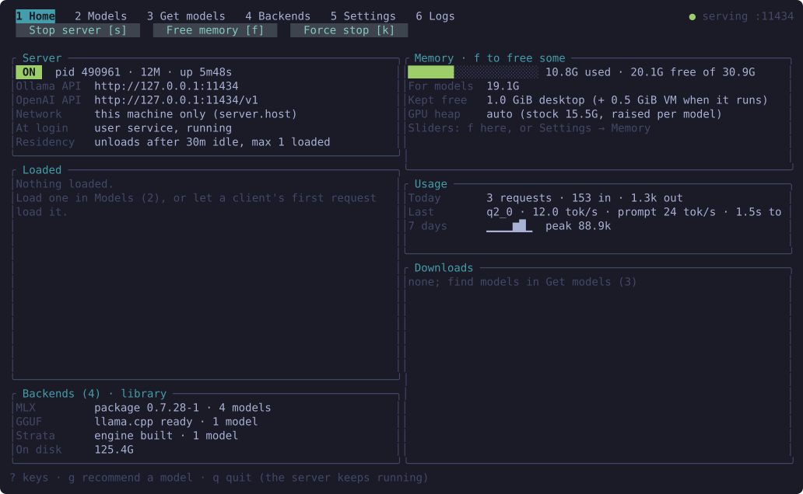
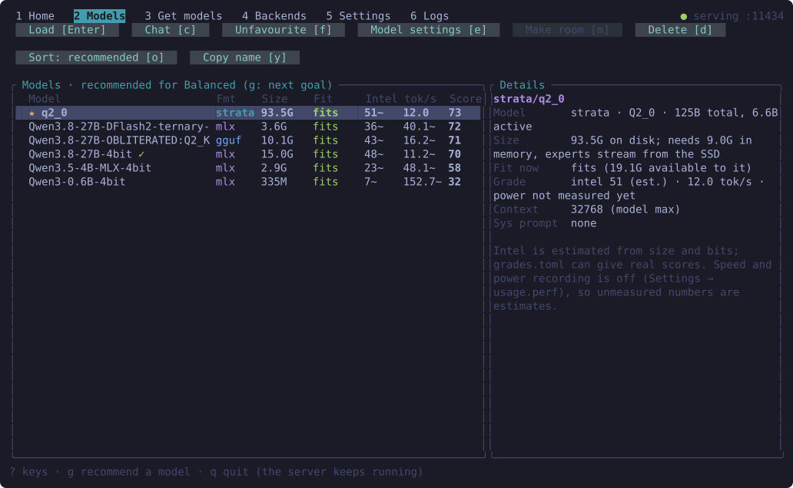
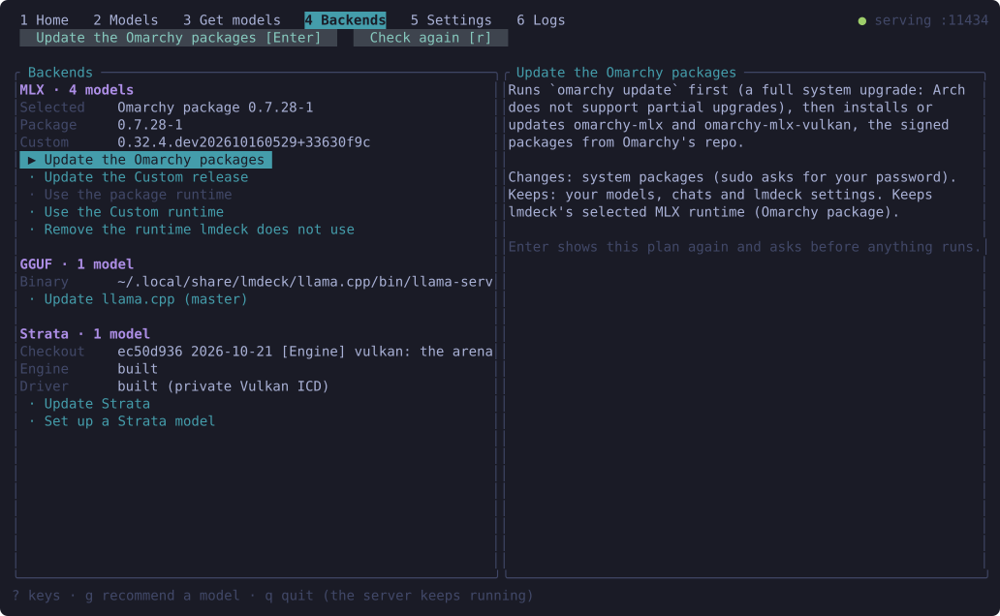
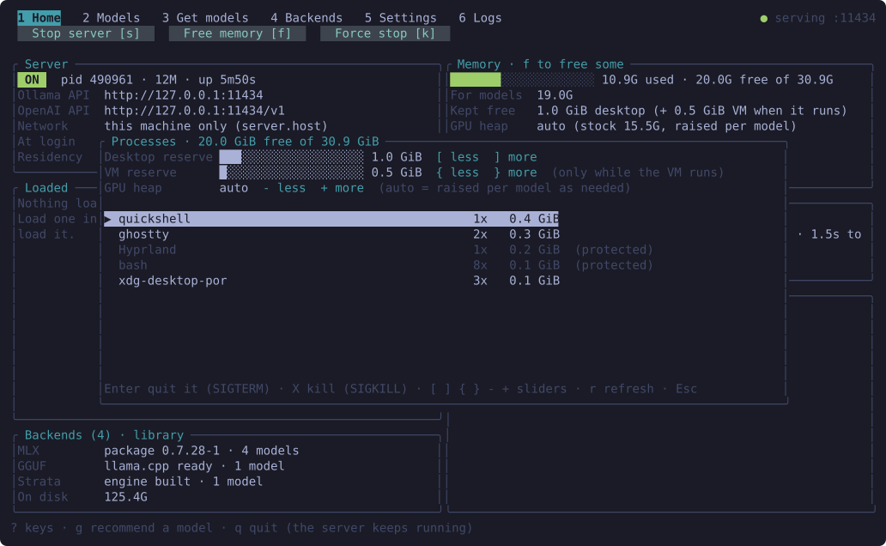
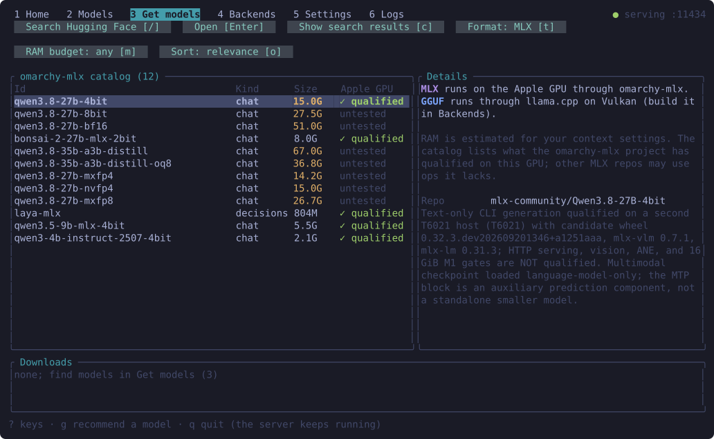
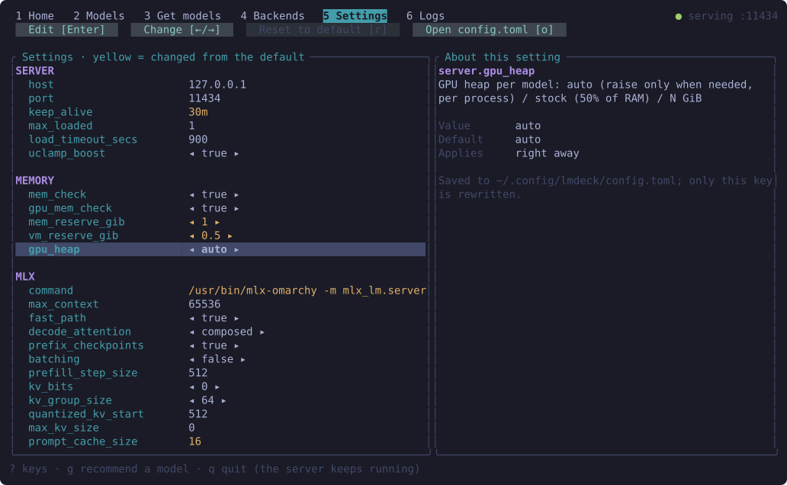

# lmdeck-DE for Asahi

Local language models on Apple Silicon under Asahi Linux, with the GPU doing the work. The main piece is
**lmdeck**: one Rust binary that is a terminal UI and an Ollama/OpenAI/Anthropic-compatible server on
`127.0.0.1:11434`. It has three backends:

| Backend | Runs | On |
|---|---|---|
| MLX | MLX safetensors models | [omarchy-mlx](https://github.com/joshuaswarren/omarchy-mlx) on the Apple GPU (Honeykrisp Vulkan) |
| GGUF | GGUF models | llama.cpp built with Vulkan |
| Strata | Qwen3.8-Flash-Next, 125B mixture of experts, experts streamed from the SSD | [strata-asahi](https://github.com/Emefedez/strata-asahi), a Vulkan port of Strata's Metal engine, on [honeykrisp-strata](https://github.com/Emefedez/honeykrisp-strata)'s driver build |

"DE" is the desktop part: Omarchy menu rows, a bar panel, a launcher entry and a VS Code fallback. All of it is
optional.

Everything was built and measured on one machine: a MacBook Pro M1 Max with 32 GB, Asahi Linux 7.1.12 and Omarchy.
Other machines are untested (see [limitations](docs/LIMITATIONS.md)).

## Repositories

| Repo | What |
|---|---|
| **lmdeck-de** (this one) | lmdeck (TUI + server), the Omarchy bar panel, the VS Code extension, the docs |
| [strata-asahi](https://github.com/Emefedez/strata-asahi) | Fork of [Niko1221/Strata](https://github.com/Niko1221/Strata). Branch `vulkan-asahi` adds `vulkan/`, the engine for Apple GPUs on Linux |
| [honeykrisp-strata](https://github.com/Emefedez/honeykrisp-strata) | Builds the Honeykrisp (Mesa) driver as a private, per-process Vulkan ICD with a 90% GPU heap and bf16 cooperative matrices, plus the GPU and SSD probes behind the port |

## Quick start

```bash
./install.sh             # build, install ~/.local/bin/lmdeck, launcher entry, Omarchy menu rows
lmdeck                   # the TUI; it starts the server when it needs it
lmdeck service install   # optional: the server starts at login
```

In the TUI, **Backends** (4) installs and updates MLX, llama.cpp and Strata. **Get models** (3) downloads models.
**Models** (2) loads them. Clients then point at `http://127.0.0.1:11434` (Ollama) or `.../v1` (OpenAI).
[docs/SETUP.md](docs/SETUP.md) has the full setup, Strata included.

## The TUI

Six screens. Each one has an action bar at the top listing exactly the keys it handles. An action that does not
apply right now is dimmed, and pressing its key says why. Only `1`-`6`, `Tab`, `g`, `?` and `q` work everywhere,
and `?` lists the keys of the screen you are on.

| Screen | For |
|---|---|
| 1 Home | Server on/off, what is loaded and how full its context is (the last request's prompt + reply against the window, live while a prompt is read, with tokens/s and time left), memory (free, kept free, GPU heap, what models can use), backends, usage, downloads; `f` opens the memory manager (reserve and heap sliders, processes, make room) |
| 2 Models | Local models with fit (the server's planner decides), grade and details; favourites (`f`, listed first), load, chat, per-model settings, make room, delete |
| 3 Get models | The omarchy-mlx catalog and a Hugging Face search, with a memory estimate and fit for each variant |
| 4 Backends | MLX, GGUF and Strata: state, and actions that show their plan and ask before they run |
| 5 Settings | Every setting, with its description, default and when a change applies |
| 6 Logs | The server's log and the loaded model's log |

Drawn from the real TUI on the M1 Max (`cargo test screenshots -- --ignored`), Tokyo Night palette:

| | |
|---|---|
|  |  |
| Home | Models, sorted by the grader (Balanced) |
|  |  |
| Backends: each action's plan before it runs | The memory manager (`f`); process list trimmed to the desktop's own |
|  |  |
| Get models: the omarchy-mlx catalog | Settings: description, default, when it applies |

### Model grader (`g`)

`g` sorts Models by a grade for a goal (Balanced, Smartest, Fastest, Efficient; `g` again for the next goal).
`lmdeck grade [goal]` prints the same table. The grade is built from whatever models you have, when you ask for it.
Nothing polls, and no model names are hardcoded:

- **Intel**: an estimate from the model's own metadata, meaning total and active parameters (config.json or GGUF
  keys) and bits per weight. It cannot tell generations or fine-tunes apart. `~/.config/lmdeck/grades.toml` takes a
  real score when you have one:
  ```toml
  [models."mlx-community/Qwen3.8-27B-4bit"]
  intelligence = 34
  ```
- **Speed**: an estimate from the weights each model reads per token. With `usage.perf = true` (off by default,
  performance first), lmdeck measures decode tok/s as you use a model and calibrates the estimate on it.
- **Power**: with `usage.perf = true`, the SMC's total system power, sampled only while a request is being served,
  which gives J/token. That costs one sensor read every 2 s during generation and about 10 KB of memory.
- **Fit**: the server's planner answers, which is the same check a load runs. Without the server, a rough estimate
  stands in, and it is marked as one.

Details and the formula are in [docs/REFERENCE.md](docs/REFERENCE.md#model-grader).

## Docs

- [SETUP.md](docs/SETUP.md): install everything, step by step
- [RESULTS.md](docs/RESULTS.md): what was measured, with what
- [NOT-WORKED.md](docs/NOT-WORKED.md): what was tried and did not help, and why
- [IDEAS.md](docs/IDEAS.md): what could come next
- [LIMITATIONS.md](docs/LIMITATIONS.md): what does not work, or was never tested
- [MODELS.md](docs/MODELS.md): what runs, and how to tell before downloading
- [PLAN-strata-in-editors.md](docs/PLAN-strata-in-editors.md): the plan to make Strata fast in VS Code and coding agents
- [WORKING-PATH-strata-in-editors.md](docs/WORKING-PATH-strata-in-editors.md): the adopted order for it, easiest first,
  with the request sizes that make the editor chat slow
- [TERNARY-PRISM.md](docs/TERNARY-PRISM.md): Prism's PQ2_0/PTQ1_0 ternary GGUFs, the second llama.cpp build, and how
  lmdeck picks it per model
- [SESSION-2026-10-23.md](docs/SESSION-2026-10-23.md): what changed in the panel, the editors and the GGUF path on
  that day, with the numbers
- [REFERENCE.md](docs/REFERENCE.md): the server's APIs, coding agents, system prompts, memory planning, settings,
  files

## License

MIT. Strata is MIT (Niko1221 and contributors). Mesa is MIT.
